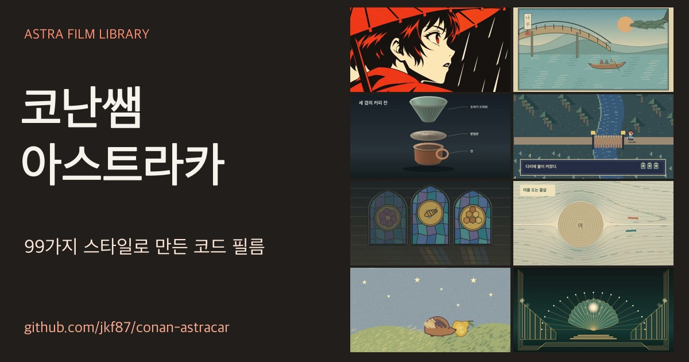

# 코난쌤 아스트라카

**99가지 스타일을 코드로 만든 한국어 단편 상영관.** Codex Astra 6.2 High 워커 세 개가 33편씩 제작했습니다. 작품 하나를 고르면 새 단편과 그 스타일의 Lemo-Opuscar 원작 데모를 같은 화면에서 볼 수 있습니다.

[**스타일 메뉴 열기**](https://jkf87.github.io/conan-astracar/#menu) · [**비교 상영관**](https://jkf87.github.io/conan-astracar/films.html) · [**23초 예고편**](https://jkf87.github.io/conan-astracar/trailer.mp4)

[](https://jkf87.github.io/conan-astracar/)

99 original code-animated shorts, each paired with the official Lemo-Opuscar demo for its style. Browse the Korean catalog by English style name, watch the films, and inspect the source for every shot.

## 한 편 보기

- [네온 튜브](https://jkf87.github.io/conan-astracar/films.html?style=neon-tubes)에서 빛의 번짐과 움직임을 비교합니다.
- [우키요에](https://jkf87.github.io/conan-astracar/films.html?style=ukiyoe)에서 목판 질감과 색면의 겹침을 봅니다.
- [픽셀 RPG](https://jkf87.github.io/conan-astracar/films.html?style=pixel-rpg)에서 작은 캐릭터로 사건을 전달하는 방법을 봅니다.

메뉴는 한국어 이름, 영문명, 줄거리, 스타일 번호로 검색할 수 있습니다. 상영관의 **작품 링크 복사**로 한 쌍의 영상을 공유하고 **제작 프롬프트 복사**로 같은 스타일에 새 주제를 넣어 보세요.

## 내 컴퓨터에서 열기

사이트와 Astra MP4 99편을 함께 내려받습니다. 현재 폴더에서 다음을 실행한 뒤 브라우저에서 `http://localhost:8000`을 엽니다. 원작 영상은 원저자의 공개 서버에서 스트리밍합니다.

```sh
git clone https://github.com/jkf87/conan-astracar.git
cd conan-astracar
python3 -m http.server 8000 --bind 127.0.0.1 --directory site
```

## 같은 스타일로 새 작품 만들기

먼저 Codex CLI에서 사용할 Lemo-Opuscar 스킬을 설치합니다. 다음은 macOS 또는 Linux의 신규 설치 예시입니다. Node.js 20 이상, FFmpeg 7 이상과 Python 3.11 이상 또는 uv가 필요합니다.

```sh
git clone https://github.com/lemomo-ai/lemo-opuscar.git ~/lemo-opuscar
git -C ~/lemo-opuscar checkout --detach 00a7f9ec99c8686265a8ca4ed9a3fdaaf27ea6f4
mkdir -p ~/.codex/skills
ln -s ~/lemo-opuscar/plugin/skills/lemo-opuscar ~/.codex/skills/lemo-opuscar
(cd ~/lemo-opuscar && sh plugin/skills/lemo-opuscar/scripts/setup.sh deps)
```

저장소 안에서 `menu`로 스타일을 고릅니다. `prompt`는 지시문을 출력합니다.

```sh
python3 astracar.py menu
python3 astracar.py menu 네온
python3 astracar.py prompt neon-tubes "비 오는 날 문을 여는 동네 세탁소"
```

`make`는 명령을 실행한 폴더에서 Codex를 `gpt-6.2-astra`, 추론 강도 `high`로 시작합니다. 로그인한 계정에서 해당 모델을 사용할 수 있어야 합니다. 다음은 새 작품의 파일을 별도 폴더에 만드는 예시입니다.

```sh
ASTRACAR_PROJECT="$(pwd)"
mkdir -p ~/Movies/astra-laundry
cd ~/Movies/astra-laundry
python3 "$ASTRACAR_PROJECT/astracar.py" make neon-tubes "비 오는 날 문을 여는 동네 세탁소"
```

## 공개된 단편 다시 렌더하기

각 제작 폴더의 설명에서 필요한 패키지와 명령을 확인할 수 있습니다. 카탈로그 번호 순서대로 세 묶음에 나누었습니다.

| 제작 묶음 | 수량 | 내용 |
| --- | ---: | --- |
| [Unit 1](production/unit-1/) | 33편 | 편집·다큐, 회화, 스케치, 전통 공예, 판화 |
| [Unit 2](production/unit-2/) | 33편 | 그래픽, 도해, 만화, 게임, 필름 |
| [Unit 3](production/unit-3/) | 33편 | 인터페이스, 발광, 미니어처, 관측, 지도 |

예를 들어 macOS에서 원본 영상을 쓰지 않고 Astra 네온 단편을 다시 그릴 때는 아래처럼 실행합니다. 시스템에 Cairo와 FFmpeg가 필요합니다.

```sh
python3 -m venv .venv
.venv/bin/python -m pip install -r requirements-render.txt
.venv/bin/python production/unit-3/render.py neon-tubes
```

배포용 메뉴를 다시 만들거나 결과물을 검사할 때는 저장소 루트에서 실행합니다.

```sh
python3 tools/build_catalog.py ~/lemo-opuscar
python3 tools/verify_films.py
```

## 재현 확인

새 단편 99편은 768×432이며, 각 9초 또는 10초입니다. 전체 상영 시간은 15분 24초입니다. 제작에 쓴 버전으로 별도 Python 환경을 구성한 뒤 99편을 다시 렌더해 MP4와 대표 JPEG의 SHA-256을 대조했습니다. 같은 macOS 기기, 글꼴, FFmpeg와 Cairo를 사용했습니다. 원작 99편은 원저자가 공개한 SHA-256 목록과 대조했습니다.

## 원작과 크레디트

원작은 **Lemo-Opuscar by Lemomo (LemoLab)** 입니다. 원저자는 데모를 Claude Opus 5.5로 만들었다고 설명합니다. Astra 단편은 같은 스타일을 새로운 내용과 짧은 러닝타임으로 해석했습니다. 원본 가이드, 영상과 포스터, 제3자 자료의 이용 조건은 따로 표기되어 있습니다. 일부 Astra 작품에는 실측 자료 또는 별도로 생성한 캐릭터 원화가 들어갑니다. [원본 저장소](https://github.com/lemomo-ai/lemo-opuscar) · [저작자와 자료 출처](NOTICE.md)

**목표는 GitHub Star 1,000개입니다.** 마음에 드는 단편의 링크를 공유하거나 이 저장소의 **Star**를 눌러 주세요. [GitHub 저장소 열기](https://github.com/jkf87/conan-astracar)
